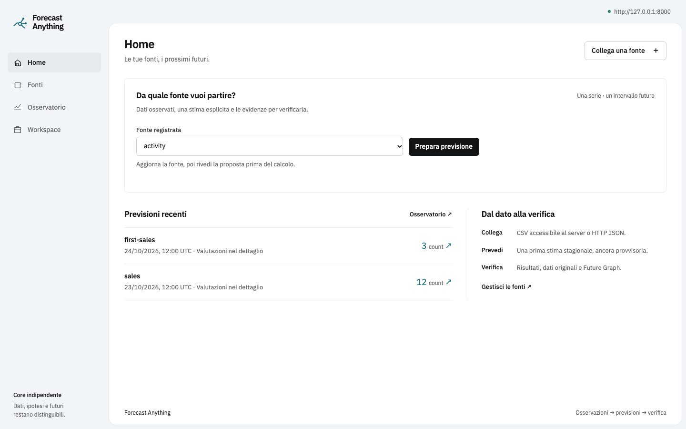
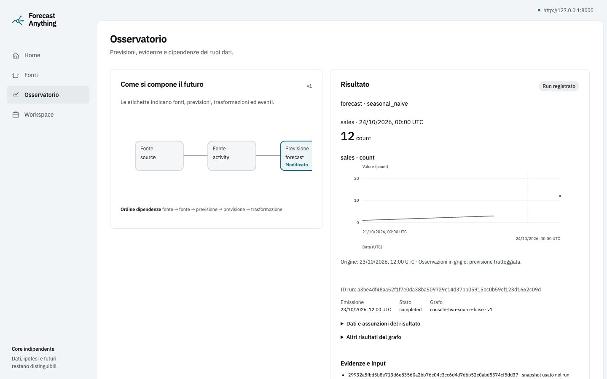

# Product frontend verification — 2026-10-29

The owner approved the [product frontend design](../superpowers/specs/2026-10-27-product-frontend-design.md). This milestone replaces the technical single-page console with Home, Fonti, Osservatorio and Workspace, keeping the same API and numerical runtime. Browser upload and configurable multi-origin backtesting remain subsequent functional milestones; the five-person usability study remains on hold.

## Visual direction

TasteSkill **Framed sheet**, seed **260034763**, with no redraw: blue-grey chrome, a white work surface and teal on data. IBM Plex Sans 400/500/600 is bundled locally with its OFL license; technical JSON uses a single system monospace stack. No remote font request is needed at runtime.

The product's signature is the forecast origin: observed history before it, an issued point or dashed forecast after it, and the Future Graph beside the result. No confidence band is invented for a point-only forecast. Historical observations require the selected forecast's direct history source and its recorded snapshot binding; ambiguous provenance remains unavailable.

Each screen answers one question:

- Home: which source can I use, and what forecasts have I issued?
- Fonti: how does the runtime interpret my data?
- Osservatorio: what was issued, what supports it, and what changed?
- Workspace: which local core am I connected to?

## Verification

| Check | Result |
| --- | --- |
| Console Vitest | 76 passed across 13 files |
| TypeScript and generated contracts | Passed |
| Production Vite build | Passed; also rebuilt by the browser test harness |
| Production browser E2E with real local API/worker | 2 passed |
| Installed-wheel/sdist release checks | 3 passed |
| TasteSkill production-state inspection, 1440/768/390 | Home: 0 FAIL, 1 WARN; Fonti and Osservatorio: 0 FAIL, 0 WARN |
| Independent final review and scoped fix re-review | No remaining Critical/Important findings; scoped tests 31 passed |

The browser journeys cover guided source mapping without JSON, activation and explicit first forecast, stale-draft invalidation, source refresh, persisted-run lineage, repeated selection of the same run, browser back/forward, return to evidence anchors with the target in view, two-source evaluation, watch revision notifications, interrupted SSE replay, graph keyboard navigation and immutable scenario comparison.

The first-forecast UI still offers the supported single-series, one-step seasonal baseline. The recorded evaluation panel exposes actual persisted metric leaves, including nested interval/pinball metrics through a disclosure. It does not run a new multi-origin backtest or claim that an unevaluated result is reliable. Failed evaluation reads are distinguished from confirmed absence.

Screenshots were obtained from the production browser journeys against deterministic, synthetic `sales`, `activity` and `first-sales` fixtures. Their small numbers, dates and run IDs are test evidence, not a claim about real forecast quality. They are not production seed content; actual workspaces read their own sources and ledger. The visual inspector measured exported DOM states with current form selections preserved, scripts removed and password values excluded; interaction was verified separately in the live E2E.

## Visual critique

ROUND 1

Seen in one second: a forecasting workspace and its next action.

Idea: the source, issued future and supporting graph are the application's visual material.

Live thing: prepare a real source-backed forecast and open its persisted result.

Layout words by section: home=source action/recent rows; sources=catalogue/guided form; observer=graph/result/evidence; workspace=connection form.

Scores: design 7.0 · usability 7.5 · creativity 6.5 · content 7.5 → overall 7.2.

Caps applied: app-screen rules apply; photography and motion floors for marketing pages do not.

Top three problems and fixes:

1. The phone workspace label sat 12px from the edge. Increased the header inset to 18px.
2. The initial source state used two different CSS names for the same technical monospace face. Unified literal-code styles; final font-count warning disappeared.
3. Technical history and duplicate result charts dominated the observer. Selected one primary chart, moved result/graph ahead of the feed, and disclosed technical outputs, snapshot contents and event history. Visual checking also caught nested metrics rendered as objects; replaced them with scalar-leaf values and tested the real shape.

ROUND 2 — final

Seen in one second: the source action on Home, and the actual forecast next to its graph in the observer.

Idea/live thing/layout: unchanged, using actual persisted values.

Scores: design 7.3 · usability 7.7 · creativity 6.5 · content 7.7 → overall 7.4.

Caps applied: no unresolved measured FAILs. All final viewport folds and page sheets were opened and inspected.

The remaining Home `panel-void` warning measures the full-height application sheet below two real run rows. This is the fixed workspace frame, not a stretched data panel; it is retained without adding invented metrics or filler. The static app lint has no FAILs; its warnings concern dormant legacy kicker selectors, literal JSON type, a floating-menu shadow and field-label separators. No rendered decorative eyebrows or resting-panel shadows remain.

The guided form remains long on phones because availability, identity, revisions and missing-value semantics must stay explicit. Further onboarding refinement can follow real usage; browser upload and interactive backtesting are tracked in the product roadmap, rather than represented by nonfunctional controls.

No found photographs, stock illustrations or generated proof are used. The screenshot-only fixture values do not require replacement in the product bundle because they are never bundled into the application.
